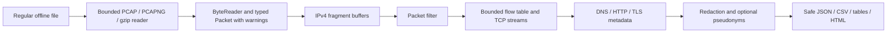

# pcaplens

Offline packet metadata analysis with hand-written, bounds-checked Python parsers.
Python 3.10+; terminal CLI; no GPU, live capture, decryption, or extracted-file export.

This repository contains the implementation, synthetic fixtures, tests, evaluation
harnesses, safety contract, and a [19-phase learning guide](docs/phases.md).
[Measured results and limitations](docs/evaluation.md) distinguish cloud evidence
from the public captures, authorized lab data, and laptop measurements you must
supply locally. It is a portfolio project, not a validated forensic or IDS product.

## Safety and privacy

Analyze only synthetic captures, public samples after checking their terms, and
captures from your own authorized isolated lab. Monitoring networks you do not
own or have authorization to monitor can violate interception and privacy laws.
This is general information, not legal advice. Read [SAFETY.md](SAFETY.md).

Treat every capture as hostile. Do not execute or open captured payloads. The
analyzer stores bounded transient bytes for parsing and hashing; reports contain
metadata and hashes. Credentials and all URL query values are redacted by default.
`--anonymize` adds consistent per-run keyed IP/MAC pseudonyms, including embedded
address literals. DNS names, URL paths, timestamps and content hashes may still
identify activity: pseudonymization is not a guarantee of anonymous data.

Only reviewed synthetic fixtures belong in Git. `samples/`, `results/`, and
`reports/` are ignored, as are capture extensions outside `fixtures/`. Renaming a
capture can bypass extension rules: always review staged contents and history.

## Start in the existing checkout

On Ubuntu/WSL2 install Python 3.10+, venv, Git, and Make through your OS package
manager. Wireshark GUI is optional for manual study; tshark is optional for oracle
tests. On Windows, use WSL2 for the terminal and Windows Wireshark for inspection.
[Phase 1](docs/phase1.md) explains the setup and a synthetic hex-mapping exercise.

```bash
bash scripts/bootstrap.sh
source .venv/bin/activate
make check test
pcaplens summary fixtures/protocols-le-us.pcap --checksum --format table
```

Bootstrap installs the exact direct/transitive versions in `requirements.lock`
and the editable package. Versions were selected for compatibility, not because
they are the latest releases. Check current upstream documentation when an API or
command fails; update pins deliberately and rerun all validation. Package
signature, checksum, and TLS verification must remain enabled.

Expected smoke result: 14 packets, 971 captured bytes, 1.3 seconds, three transport
flow instances, and no warnings. The synthetic capture includes DNS, cleartext
HTTP, ARP, VLAN, ICMP, IPv6/ICMPv6, and reassembled IPv4 fragments. TLS and TCP
sequence edge cases have separate fixtures.

## Commands

```bash
pcaplens --help
pcaplens version
pcaplens summary fixtures/protocols-le-us.pcap
pcaplens flows fixtures/reassembly.pcap
pcaplens dns fixtures/protocols-le-us.pcap
pcaplens http fixtures/protocols-le-us.pcap
pcaplens tls fixtures/tls.pcap
pcaplens follow fixtures/reassembly.pcap
pcaplens filter fixtures/protocols-le-us.pcap --expression 'tcp and port 80'
pcaplens filter fixtures/protocols-le-us.pcap --expression 'ip.src in 192.0.2.0/24 and not arp'
pcaplens hierarchy fixtures/protocols-le-us.pcap
pcaplens talkers fixtures/protocols-le-us.pcap
pcaplens detect fixtures/protocols-le-us.pcap
mkdir -p reports
pcaplens export fixtures/protocols-le-us.pcap --format json --output reports/metadata.json
pcaplens export fixtures/protocols-le-us.pcap --format csv --output reports/metadata.csv
pcaplens report fixtures/protocols-le-us.pcap --output reports/metadata.html
pcaplens summary fixtures/protocols-le-us.pcap --timeline-plot reports/timeline.png
```

Outputs are exclusive-created: remove only your generated output or choose a new
name to repeat. `follow` reports stream offsets, observed-byte counts, gaps,
limits, retransmission estimates, and run hashes; it never exports payload bytes.
HTML is one script-free file with escaped sections and an inline SVG timeline.
CSV uses section/value rows so settings, scan identity, and diagnostics remain
part of the export. Rich tables treat data as plain text, not markup.

All analysis commands accept `--limits`, `--settings`, `--expression`,
`--checksum/--no-checksum`, `--overlap first|last|reject`,
`--anonymize/--no-anonymize`, `--progress`, `--format`, and `--output`.
`--no-redact` is an explicit privacy opt-out. CLI options override settings.

```bash
pcaplens summary fixtures/protocols-le-us.pcap \
  --limits configs/limits.yaml --settings configs/default.yaml --progress
```

Exit 0: completed without recorded warnings. Exit 1: configuration or output
failure. Exit 2: argument error, malformed/unsupported input, a resource limit,
or other recorded capture warning. Warnings do not imply malicious traffic.
JSON remains on stdout and progress/diagnostics stay on stderr.

## Architecture and bounds



Each capture is streamed. Active flow and fragment tables, TCP data and presence
maps, warning samples, timing samples, and retained metadata have explicit caps.
The total TCP budget accounts for both byte arrays, not all Python overhead.
The metadata byte budget is serialized JSON size, not an RSS guarantee; evaluation
measures process RSS separately. Eviction, gaps, timeouts and metadata suppression
are reported. Protocol numeric constants follow wire standards; tunable budgets
and analysis settings live in [configs](configs/).

Supported inputs: both byte orders and micro/nanosecond classic PCAP; section-aware
PCAPNG with IDB/EPB, obsolete PB, SPB, timestamp resolutions/offsets and multiple
interfaces; optional `.gz` files with whole-file expansion-ratio and size caps.
Ethernet II, stacked VLAN, Linux SLL v1 and raw IP are implemented. Other link
formats are reported as unsupported.

Scapy/dpkt are confined to tests, fixture generation and benchmarks; they are
never imported under `src/pcaplens/`. Packet parsing uses `ByteReader`; structural
errors become bounded warnings. Optional checksum mismatches are warnings, since
capture offload can invalidate checksums in otherwise useful captures.

## Reproduce validation

```bash
make fixtures                 # deterministically regenerate synthetic files
make check test               # ruff, strict mypy on src, synthetic pytest suite
make oracle                   # requires tshark in PATH; offline only, -n
make fuzz                     # 10,000 seeded mutations, per-case deadlines, RSS
make bench                    # three sizes/repeats; dpkt baseline and ablations
make detect-eval               # synthetic labels, threshold/jitter sensitivity
make wheel
python scripts/audit_repository.py
```

Oracle field names are verified against the installed `tshark -G fields`; its
version is saved in results. For a nonstandard executable use
`make oracle TShark=/path/to/tshark`. Inspect every disagreement; empty comparisons
are unmeasured, not 100% agreement. See [evaluation](docs/evaluation.md) for how to
add samples you downloaded yourself after checking their terms, and labeled lab
captures without committing them.

The CI workflow runs synthetic validation on Python 3.10 and 3.12. CI configuration
is included; a passing local run does not claim a GitHub Actions run occurred.

## Important limits of interpretation

- Application protocol counts are per-packet signatures, not retrospective labels
  on every TCP continuation. Application metadata uses bounded reassembled runs.
  An application filter can omit continuations; transport/IP filters preserve
  more stream context. No filter silently changes its semantics into a flow filter.
- IPv4 overlap is conservatively rejected; identical duplicate fragment bytes are
  ignored. Non-atomic IPv6 fragments, jumbograms, SLL2, 802.3 LLC, tunnels, ESP
  contents, and HTTP/2 are unsupported. Unknown protocols are counted/skipped.
- TCP ordering assumes less than half the 32-bit sequence space per stream.
  First/last/reject overlap policy is explicit. Missing bytes are never invented.
  The flow state is light observed flag tracking, not proof of a valid handshake.
  Tuple reuse without a closing FIN/RST or timeout can be ambiguous.
- HTTP parser rejects ambiguous lengths/folded headers/unsupported transfer
  encodings. It supports Content-Length, chunking, interim responses, known HEAD
  context, and CONNECT/101 upgrades; upgraded protocols are not parsed. Responses
  without captured requests have unknown method context. Close-delimited bodies
  have unproven closure, and incomplete framing produces warnings. Bodies and form
  values are never stored in reports. Concatenated gzip HTTP entities are rejected.
- TLS parses cleartext ClientHello/ServerHello metadata within bounded records and
  handshake buffers. It does not decrypt records or claim visibility into encrypted
  handshakes, ECH-protected names, or later encrypted negotiation.
- Application timestamps use the owning flow's first timestamp, not the exact byte
  arrival time. SPB timestamps are missing and explicitly warned. Sub-nanosecond
  PCAPNG time units are rounded down to integer nanoseconds.
- Conversations count frames with decoded L4 endpoints; earlier IP fragments have
  IP counts but are not retroactively attributed to transport flows. Endpoint byte
  totals count each frame at both endpoints. Timeline bins are captured bytes/s;
  missing retained bins are drawn as zero and suppression is exposed.
- Heuristics express hypotheses. The synthetic label experiment includes benign
  lookalikes and false positives; it is not a real-world IDS accuracy claim.

[Packet byte layouts](docs/how_packets_work.md), [capture formats](docs/file_formats.md),
[resource-limit test index](docs/limits.md), and the [publication checklist](docs/checklist.md)
provide the details and exact local commands. Review and commit locally before
following the GitHub publication commands. Nothing has been pushed automatically.
