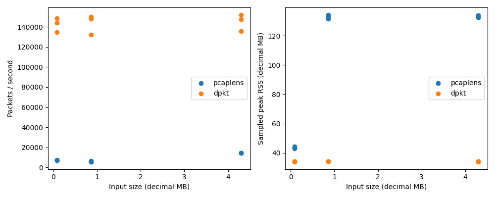
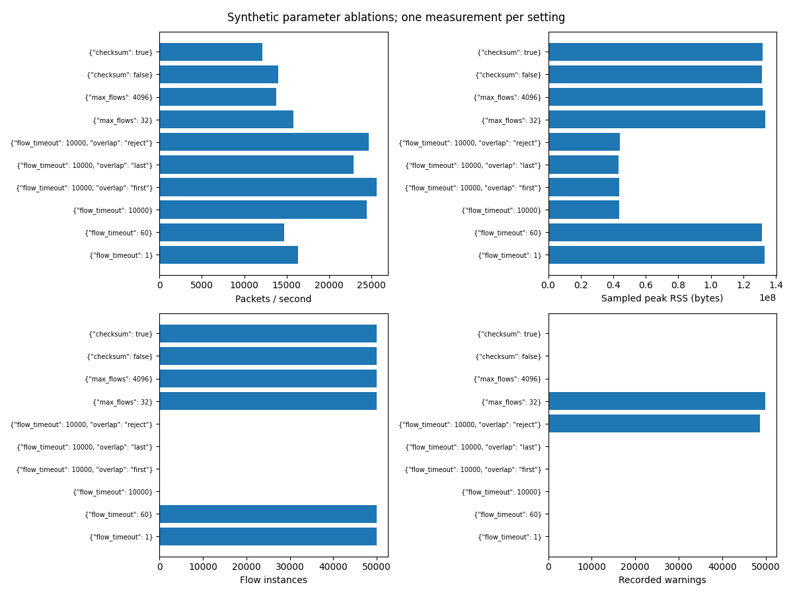
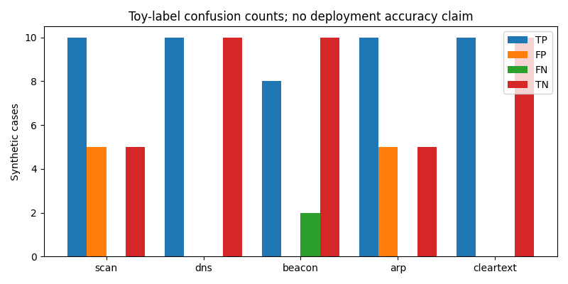
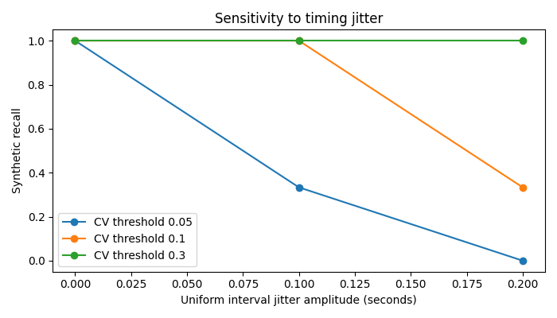

# Measured validation and what remains local

The implementation and all 19 phase guides are present. Evidence below was
actually measured in the cloud checkout on 2026-10-11 (UTC); it is not a report from
an i3/8 GB laptop. Only generated synthetic captures were analyzed. No public
sample or user lab capture was supplied. Manual Wireshark exercises, those
external datasets, laptop measurements, and a real GitHub Actions run remain
explicitly unverified. Do not present them as completed portfolio evidence.

## Build and test evidence

Python 3.12.14 and 3.10.16 each passed **110 tests**, including the optional
offline tshark test, on the final source. Ruff lint/format and strict mypy over
51 runtime modules passed. The wheel was built and tested separately on Python
3.10 from outside the source checkout. Both Python versions produced identical
fixture hashes. Scapy/dpkt are excluded from runtime imports by a source audit.
A conservative working-file/history audit found no issues; the checkout had zero
historical commits. See the [audit limitations](checklist.md) before publication.
CI is configured for both versions but has not run on GitHub.

[validation.json](evidence/validation.json) records source/configuration hashes
and the scope of these checks. Pinned dependencies are in requirements.lock.
Numerical benchmarks are observations from these fixed experiments, not general
accuracy, memory, or throughput guarantees.

## Offline tshark agreement

Reference: **TShark (Wireshark) 4.4.18**. The harness checks field names against
`-G fields`, uses `-n` and offline `-r`, bounds subprocess output and duration,
and captures its version. Read the installed manual and
[official tshark manual](https://www.wireshark.org/docs/man-pages/tshark.html)
when flags or fields differ. No live interface is opened.

Eleven synthetic container/case files were checked: all four classic PCAP
variants, both PCAPNG byte orders with multiple interfaces/resolutions, TCP
out-of-order/retransmission and wraparound cases, fragmented TLS handshakes,
raw IP, and Linux SLL. Endian/precision variants share generated packets; they
are format coverage, not eleven independent network workloads.

The denominator is the union of compared field keys, not packet-level accuracy.
Empty comparisons are `null`, not 100%. These totals include duplicated protocol
variants and should not be used as an independent-sample statistical estimate.

| Field | Agreed/compared keys | Agreement |
| --- | ---: | ---: |
| packet_count | 11/11 | 100.00% |
| protocol_counts | 67/67 | 100.00% |
| protocol_hierarchy | 71/79 | 89.87% |
| conversation_packets | 17/17 | 100.00% |
| conversation_bytes | 17/17 | 100.00% |
| conversation_captured_bytes | 17/17 | 100.00% |
| dns_queries | 10/10 | 100.00% |
| dns_a_answers | 6/6 | 100.00% |
| http_requests | 4/4 | 100.00% |
| conversation_table_packets | 17/17 | 100.00% |
| conversation_table_exact_bytes | 17/17 | 100.00% |

TCP follow output matched byte-for-byte in **14/14
directions**, including an empty reverse direction. Raw reference bytes remain
transient; only lengths/equality and metadata are written. Ambiguous tuple reuse,
gaps or limits are explicitly unmeasured. The oracle is a reference, not truth.

All 8 recorded differences are two repeated hierarchy scope
differences across the four PCAP variants:

1. `ethernet/ipv4/data`: tshark represents two non-final IPv4 fragment payloads
   as opaque data. pcaplens records IPv4, buffers the fragments, and attributes
   decoded UDP/DNS only when the datagram completes; it has no opaque data node.
2. `ethernet/ipv4/tcp/http/data`: tshark represents the five-byte synthetic HTTP
   response body as data. pcaplens records its length/hash under HTTP metadata
   and creates no body-protocol hierarchy node.

Both differences are retained in the agreement denominator and described in
[oracle.json](evidence/oracle.json). The harness verifies fixture hash provenance
before applying those explanations. There are no unexplained differences in
this synthetic run. Only A-record answers are oracle-compared here; other common
DNS types have generated-ground-truth unit tests. This does not imply universal
Wireshark equivalence or application classification on every continuation frame.
Conversation byte fields compare original and captured frame lengths separately;
actual `-z conv` packet/exact-byte tables are also checked. Rounded table units
are reported as unmeasured. Transparent layer aliases and adjacent duplicate
TLS layers are documented explicitly in each capture result.

Reproduce this entire corpus (the shorter `make oracle` checks three cases):

```bash
source .venv/bin/activate
python eval/oracle_tshark.py \
  fixtures/protocols-le-us.pcap fixtures/protocols-be-us.pcap \
  fixtures/protocols-le-ns.pcap fixtures/protocols-be-ns.pcap \
  fixtures/interfaces-le.pcapng fixtures/interfaces-be.pcapng \
  fixtures/reassembly.pcap fixtures/wraparound.pcap fixtures/tls.pcap \
  fixtures/raw-ip.pcap fixtures/sll.pcap --tshark tshark
```

For this retained cloud tool only, replace `tshark` with
`/workspace/pcaplens-tools/tshark/tshark`. It was extracted from authenticated
Debian packages outside the project. A fresh local checkout needs its own
Wireshark/tshark installation; the tool binaries are not part of the MIT archive.

## Mutation robustness and budgets

Seed 20250317; **10,000 cases**, exactly 2,500 of each bit-flip,
truncation, length tampering, and field-swap mutation, from four synthetic seeds.
Observed uncaught exceptions: **0**; observed
one-second timeouts: **0**. Elapsed 5.86
seconds; sampled peak RSS **29.57 MiB** at
2 ms sampling. This finite campaign cannot prove crash freedom or catch every
short-lived allocation peak. Per-case timers require POSIX (Linux/WSL2).

The smaller campaign limits and per-code warning counts are saved in
[robustness.json](evidence/robustness.json); do not confuse them with production
defaults. Dedicated tests separately trigger all [resource budgets](limits.md),
including compression/pointer loops, huge declared lengths, IPv6 chains,
10,000 tiny fragments, shared reassembly caps, and metadata/warning suppression.
IPv4 total reassembled length includes the first fragment's header length.
Reassembly accounts data and presence arrays; metadata accounts serialized JSON,
while Python object overhead is assessed using RSS. Limits are engineering
bounds, not a claim of a formal proof against every possible malicious capture.

```bash
make fuzz
pytest -q tests/test_adversarial.py tests/test_regressions.py
```

## Performance, memory and profile

Execution machine: x86_64, 5 logical CPUs,
33.29 GiB reported RAM, Python 3.12.14.
It differs from your laptop. Each engine runs in an isolated subprocess, three
repeats per size; table throughput is the median and RSS is the maximum sampled
peak. Decimal MB/s uses input file size. The largest capture here is 4.30 MB,
not 100 MB. RSS is sampled with psutil every 2 ms and can miss brief peaks.

**Workloads differ:** dpkt performs parse-only L2-L4 decoding; pcaplens performs
full flow/stream analysis, metadata retention, sanitization/redaction and hashing.
This baseline measures an engineering tradeoff, not an equal-work algorithm race.
Generated packets cycle 128 tuples, contain conflicting overlap bytes and
one-second timestamp gaps. Default timeout expires many flow instances. Metadata
retention saturates at larger sizes, records suppression, and therefore changes
work per packet: the larger-file throughput is not a linear scaling forecast.

| Packets | File bytes | Engine | Median packets/s | Median MB/s | Peak sampled MiB |
| --- | ---: | --- | ---: | ---: | ---: |
| 1,000 | 86,024 | pcaplens | 7,021 | 0.604 | 42.16 |
| 1,000 | 86,024 | dpkt | 144,001 | 12.388 | 32.58 |
| 10,000 | 860,024 | pcaplens | 5,815 | 0.500 | 128.16 |
| 10,000 | 860,024 | dpkt | 148,124 | 12.739 | 32.64 |
| 50,000 | 4,300,024 | pcaplens | 14,433 | 1.241 | 127.81 |
| 50,000 | 4,300,024 | dpkt | 147,738 | 12.706 | 32.54 |



The saved cProfile run measures 50,000 packets under default full analysis.
Instrumented time must not be substituted for the uninstrumented throughput.
Cumulative times overlap because they include child calls:

| Function | Self seconds | Cumulative seconds |
| --- | ---: | ---: |
| `table.py:85:add` | 0.846 | 3.314 |
| `registry.py:13:dissect` | 0.241 | 2.326 |
| `table.py:79:remove` | 0.064 | 1.914 |
| `summary.py:95:finished` | 0.197 | 1.750 |
| `sanitize.py:15:sanitize` | 0.395 | 1.021 |
| `redact.py:25:redact` | 0.470 | 0.808 |
| `ipaddress.py:1286:__init__` | 0.156 | 0.807 |
| `ipv4.py:23:parse` | 0.235 | 0.716 |

The profile identified flow handling, parsing, retained-output work and
sanitization/redaction as important costs. ASCII sanitization has a bounded fast
path with tests; this report makes no controlled causal speedup claim. Optimize
only after measuring your actual workload. Full top-25 profile and all raw repeats
are in [performance.json](evidence/performance.json); rows/settings are also
[CSV](evidence/performance.csv).

## Ablations

Single runs per setting on the same 50,000-packet generated input; these are
sensitivity illustrations without confidence intervals. Other settings remain
at their defaults, except overlap runs hold the long timeout fixed. `flows`
counts emitted flow instances over the run, not simultaneous table occupancy.

| Setting changes | Flow instances | Warning count | Packets/s | Peak sampled MiB |
| --- | ---: | ---: | ---: | ---: |
| flow_timeout=1 | 50,000 | 1 | 16,350 | 126.79 |
| flow_timeout=60 | 50,000 | 1 | 14,671 | 125.33 |
| flow_timeout=10000 | 128 | 1 | 24,412 | 41.45 |
| flow_timeout=10000, overlap=first | 128 | 1 | 25,614 | 41.77 |
| flow_timeout=10000, overlap=last | 128 | 1 | 22,888 | 41.30 |
| flow_timeout=10000, overlap=reject | 128 | 48,721 | 24,670 | 42.11 |
| max_flows=32 | 50,000 | 49,969 | 15,764 | 127.43 |
| max_flows=4096 | 50,000 | 1 | 13,742 | 125.84 |
| checksum=False | 50,000 | 1 | 14,031 | 125.33 |
| checksum=True | 50,000 | 1 | 12,162 | 125.59 |

Long timeouts merge repeated tuples; short timeouts split them. A 32-entry flow
cap forces eviction among 128 tuples. First/last/reject policies yield different
stream hashes on deliberate conflicting overlaps; rejecting conflicts records
many warnings while bounded warning retention prevents linear diagnostic growth.
Checksum validation adds work; valid generated checksums do not add checksum
warnings. The common single warning in many runs is metadata-retention
suppression, not corruption. Saved stream-metadata digests are over retained
metadata, so they are not hashes of every flow ever emitted.



```bash
make bench
```

Run that command on your i3/8 GB laptop; keep its results separate. Captures are
temporary synthetic files and are deleted after measurements. Increase sizes
only while measuring RSS and inspecting warnings; no GPU or Kaggle is needed.

## Heuristic evidence, not verdicts

Seed 20250317; 20 toy labeled cases per family (10 positive/10
negative). Labels are generation intent, not real-world maliciousness. Negative
scan cases include broad authorized probes and ARP cases include legitimate
mapping changes; these are deliberately indistinguishable from some alert
patterns. Case-level evaluation asks whether at least one family alert appears.
It does not measure event attribution, calibration or operational detection rates.

| Family | Threshold | TP/FP/FN/TN | Precision | Recall | False-positive rate |
| --- | ---: | --- | ---: | ---: | ---: |
| scan | 20 | 10/5/0/5 | 66.7% | 100.0% | 50.0% |
| dns | 4.0 | 10/0/0/10 | 100.0% | 100.0% | 0.0% |
| beacon | 0.1 | 8/0/2/10 | 100.0% | 80.0% | 0.0% |
| arp | None | 10/5/0/5 | 66.7% | 100.0% | 50.0% |
| cleartext | None | 10/0/0/10 | 100.0% | 100.0% | 0.0% |




Threshold and jitter rows, false positives and missing denominators are saved in
[detection.json](evidence/detection.json) and [CSV](evidence/detection.csv).
The DNS experiment exercises generated-name entropy; NXDOMAIN/length behavior
has unit tests but no operational corpus evaluation. Cleartext testing identifies
header/query-key presence, with values withheld. No form/body contents are
exported. No labeled authorized lab captures were supplied, so lab precision and
recall are **unmeasured**. These heuristics must never be marketed as verdicts.

```bash
make detect-eval
```

## Required local datasets and external checks

Download your own small public samples only after checking the source's terms.
[Wireshark's sample-capture page](https://wiki.wireshark.org/SampleCaptures) is a
source catalog, not a blanket permission grant. Record provenance/license and
allowed use locally under ignored samples/. Do not commit downloaded captures,
raw host identities, credentials or their reports. No capture download URL is
invented here. Once you have an authorized file named samples/public.pcap:

```bash
mkdir -p samples results/public
python eval/oracle_tshark.py samples/public.pcap \
  --tshark tshark --output results/public/oracle.json
pcaplens summary samples/public.pcap --anonymize --progress
```

Inspect every difference and append a local evidence-based diagnosis; do not
apply synthetic explanations to real files. An unexplained mismatch is unresolved
validation, not a rounding error to hide. Public corpus agreement remains pending.

For your own isolated lab, create an ignored `samples/lab/labels.json` with
relative capture names and explicit case labels, for example:

```json
[
  {"family": "scan", "label": true, "file": "labeled-scan.pcap"},
  {"family": "scan", "label": false, "file": "labeled-benign.pcap"}
]
```

Families are scan, dns, beacon, arp and cleartext. Label positives and negatives
from the lab experiment before looking at predictions. Do not relabel false
positives to improve scores. Results with parse warnings are excluded and listed,
not silently counted as clean cases. Verify their exclusion is appropriate.

```bash
mkdir -p results/lab
python eval/detect_eval.py --seed 20250317 \
  --lab-manifest samples/lab/labels.json --output results/lab
```

Complete the manual Wireshark mappings in [phases.md](phases.md), repeat benchmarks
locally, audit all admitted files/history and review the [publication checklist](checklist.md).
The source is implemented; external validation is an explicit remaining task
because those machines/data and your manual inspection are not available here.
